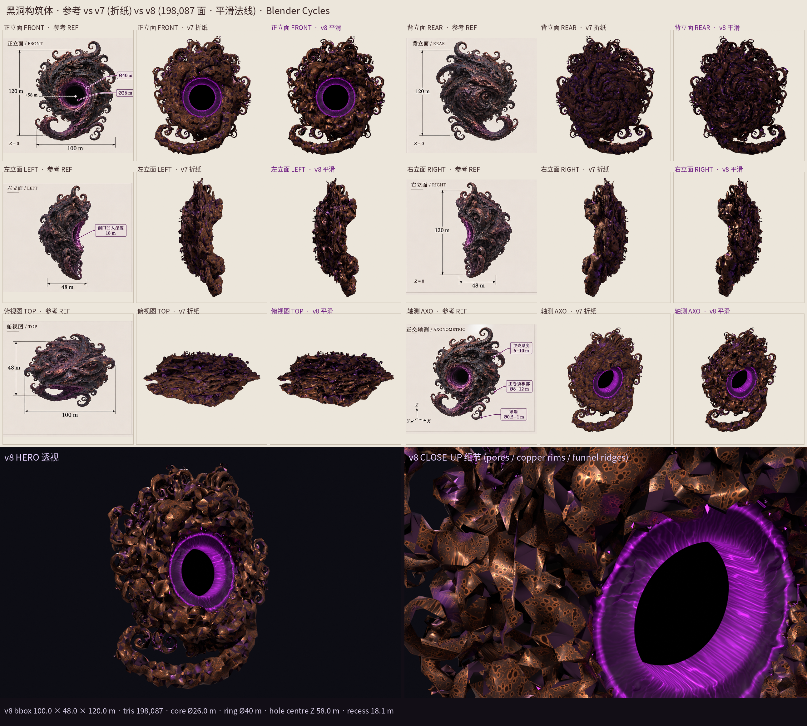

# 黑洞构筑体 · Black Hole Structure

**在线预览 / Live demo:** https://black-hole-structure.pages.dev

根据参考效果图，用 Blender（Python 脚本，bpy 5.3 无界面运行）程序化生成的"黑洞构筑体"3D 模型，附带基于 Three.js 的网页查看器。查看器支持环绕、辉光和中英文尺寸标注。
A procedural "black hole structure" 3D model generated in Blender (headless bpy 5.3 Python scripts) from a reference sheet, with a Three.js web viewer (orbit, bloom, CN/EN dimension overlay).

规格 / Spec: 包围盒 bbox 100 × 48 × 120 m（原点在底面中心，Z 轴向上，正面朝 −Y）· 洞口 opening Ø40 m 外环 / Ø26 m 内核，洞心 Z = 58 m，凹入 18 m · v8 ≈19.8 万三角面（≤20 万），自定义平滑法线（消除折纸）+ 烘焙细节法线 + Draco · smooth custom normals (no origami) + baked detail + Draco.



## 目录 / Layout

| 路径 Path | 说明 Description |
|---|---|
| `src/` | 建模、贴图、场景/渲染、校验、拼图、网页构建脚本 · build / texture / scene+render / verify / contact-sheet / web scripts |
| `model.blend` | Blender 源文件（v8 ≤200k · 平滑法线）· Blender source (v8 ≤200k · smooth n) |
| `model.glb` | v7 减面 glTF，未压缩（24.2 MB）· v7 decimated glTF, uncompressed |
| `model_draco.glb` | v7 + Draco（14.6 MB）· v7 + Draco |
| `tex/baked_detail_n.png` | 从 v6 密度网格烘焙的细节法线 · detail normal baked from mid-poly |
| `web/preview.html` | 网页查看器（已内嵌压缩模型，可离线打开）· Web viewer (compressed model embedded, works offline) |
| `web/model_web.glb` | 网页用模型（Draco + 1024 WebP，2.8 MB）· Web model (Draco + 1024 WebP) |
| `web/preview_screenshot*.png` | 无界面 Chrome 测试截图 · Headless-Chrome test screenshots |
| `renders/hero.png`, `renders/closeup.png` | Cycles 透视主图 / 细节特写 · Cycles hero / close-up renders |
| `contact_sheet.png` | 参考图与 v5 / v6 各视图对比 · Reference vs v5 vs v6 per view |
| `compare_v7_v8.png` | v7→v8 消除折纸对比 · v7→v8 anti-origami |
| `tex/`, `ref/` | 程序化贴图与参考图裁切 · Procedural textures and reference crops |
| `measure.json`, `verify.json` | 尺寸实测 · Measured dimensions |

v7 起默认 `DECIMATE=0.08`（≤20 万面）并烘焙法线；`model.glb`（24.2 MB）已提交。设 `DECIMATE=1` 可生成完整版 `model_full.glb`（约 112 MB，忽略不提交）。
Default is `DECIMATE=0.08` (≤200k) + baked normals; `model.glb` (24.2 MB) is committed. `DECIMATE=1` writes ignored `model_full.glb` (~112 MB).

## 重新生成 / Rebuild

```bash
python3 src/texture.py && SAMPLES=64 python3 src/scene.py   # textures -> mesh -> model.blend / model.glb / renders/
python3 src/verify.py && python3 src/sheet.py              # verify.json, contact_sheet.png
bash src/rebuild_web.sh && python3 src/test_preview.py      # model_draco.glb, web/model_web.glb (Draco) -> web/preview.html, headless test
python3 src/compare_sheet.py                               # compare_v5_v6.png
```

## 部署 / Deployment

推送到 `main` 后，GitHub Actions 会把 `web/` 打包到 `dist/`（`preview.html` 作为 `index.html`），并部署到 Cloudflare Pages。
Every push to `main` triggers GitHub Actions, which copies `web/` into `dist/` (`preview.html` served as `index.html`) and deploys to Cloudflare Pages.

需要的仓库 Secrets / Required repo secrets: `CLOUDFLARE_API_TOKEN`, `CLOUDFLARE_ACCOUNT_ID`.

---

## 版本记录 / Version notes

### v8：消除折纸 / anti-origami（issue #2 补充）
- **根因**：v7 减面后大三角面在金属高光下显出平面（折纸感）；漏斗等处导出法线几乎贴齐面法线；v7 的 Mix 节点还曾让部分材质导出错误的 normalTexture。
- **修复**：`remove_doubles` 焊接 → `shade_smooth` → 从 ~62 万中模 **Data Transfer 自定义法线**到低模（连续平滑着色）→ 重新烘焙细节法线（清晰 TexImage→NormalMap 路径）→ 网页 `flatShading=false` 且保留自定义法线（不再 `computeVertexNormals`）。
- **面数**：198,087 tris（仍 ≤200k）。


### v7：≤20 万面 + 烘焙法线 / ≤200k tris + baked normals（issue #2）
- **减面**：Blender Decimate 比例 0.08，2,483,108 → **198,647** 三角面（Ø40 漏斗与 Ø26 内核顶点组保护）。包围盒仍精确 100×48×120 m；洞心 Z≈58.0、内核 Ø≈26.0、凹入 ≈18.1 m。
- **烘焙法线**：以 v6 密度（ratio 0.2，~497k）为源，Smart UV `BakeUV` + Cycles 切线空间法线烘焙到 1024² `tex/baked_detail_n.png`，与程序化微法线按 0.78 混合，法线强度 2.6；网页端 `normalScale≈1.75`。
- **Draco**：网页仍内嵌解码器；`preview.html` 9.0 → **4.9 MB**。

| 文件 File | 三角面 Tris | 大小 Size |
|---|---|---|
| v6 `model.glb` | 496,621 | 30.6 MB |
| v7 `model.glb` | 198,647 | 24.2 MB |
| v7 `model_draco.glb` | 198,647 | 14.6 MB |
| v6 `web/model_web.glb` | ~496k | 5.9 MB |
| v7 `web/model_web.glb` | ~198k | 2.8 MB |
| v6 → v7 `web/preview.html` | | 9.0 → 4.9 MB |


### v6：减面 + Draco 压缩 / decimation + Draco
- **减面 Decimation**：Blender Decimate（Collapse，比例 0.2），2,483,108 → 496,621 三角面。Ø40 漏斗与 Ø26 内核用顶点组保护、不减面，减面后再把包围盒精确拉回 100 × 48 × 120 m。实测洞心 Z 58.0、内核 Ø25.94、凹入 18.14 m，与 v5 一致。
- **Draco**：`gltf-transform draco` 使用默认量化（位置 14 bit）。网页里的 Draco 解码器（wasm + wrapper）直接内嵌在 `preview.html` 中，不依赖 CDN，离线和 file:// 也能打开。

| 文件 File | 三角面 Tris | 大小 Size |
|---|---|---|
| v5 `model.glb`（完整，未压缩 full, uncompressed） | 2,483,108 | 112.3 MB |
| v6 `model.glb`（减面，未压缩 decimated, uncompressed） | 496,621 | 30.6 MB |
| v6 `model_draco.glb`（减面 + Draco decimated + Draco） | 496,621 | 15.7 MB |
| v6 减面 + meshopt（仅作对比 comparison only） | 496,621 | 16.5 MB |
| v5 `web/model_web.glb`（简化 50% + meshopt） | ~1.24M | 17.5 MB |
| v6 `web/model_web.glb`（WebP + Draco） | 495,936 | 5.9 MB |
| v5 → v6 `web/preview.html` | | 24.2 → 9.0 MB |

完整分辨率的 GLB 中有 10.2 MB 是 PNG 贴图，所以几何数据的压缩效果更明显：未压缩 20.4 MB，Draco 5.5 MB，meshopt 6.2 MB。
Full-res GLBs carry 10.2 MB of PNG textures, so geometry alone shows the gain more clearly: 20.4 MB raw → 5.5 MB Draco → 6.2 MB meshopt.


本地备份 `v1/` 至 `v5/` 未提交到仓库（v3 是放弃的分支）。v5 的几何与 v4 完全相同（build.py 未改，网格缓存复用），只调整了明暗和材质。

### v5 相对 v4 的改动（提亮）
- **贴图**：青铜底色约提亮 2.7 倍，偏炭灰紫；棱上的锈橙高光更宽、更亮；缝隙里的紫色更强。
- **Blender 材质**：
  - 顶点色铜色减半（与中性色 50% 混合），只有棱顶保持暖色。
  - 缝隙李子紫亮度约提高 2.4 倍；金属度 0.72→0.55，漫反射为主，不再整片发橙。
  - 孔边铜色减弱。
- **灯光**：主光 5→6.5，紫色轮廓光 1.6→2.4，环境光 0.22→0.35。
- **曝光**：正交视图 0.6→0.95，主图和特写 0.9→1.1。
- **网页**：toneMappingExposure 1.15→1.6；主光 3.2→4.6；新增正面补光；半球光 0.5→1.3；环境反射 0.8→1.3。
v4 以 v2 的源码为基础，保留 v2 的细节密度：卷头、分枝，以及主臂上的真实孔洞。

### v4 相对 v2 的改动（保留）
- **从 v3 带过来的安全修复**
  - 把向内的面翻正（管体原先是反向缠绕，这影响法线贴图和光照）。
  - 孔底改为不反光（Specular 0.04），去掉了灰色发白。
- **颜色**
  - 底色是炭黑偏紫的暗青铜。
  - 用两尺度 KD-tree 计算凹凸度，写入顶点色 `Tint`：只有最凸的棱边才是铜橙色，凹处偏紫。
  - Blender 中深缝隙再混入李子紫漫反射（属性 `Cav`，不发光）。
  - 贴图里锈色只出现在最高的棱上，孔边铜色减弱。
- **正面旋涡**
  - 11 条粗主臂从漏斗边缘起，沿更长的螺旋（2.3–2.9 rad）向外卷，主臂保留孔洞。
  - 主臂之间的槽里穿插 11 条细的紫脉臂。
  - 正面壳体的螺旋凸纹改成和主臂同样的扭转率，让沟槽加强旋涡的走向。
- **尾巴**
  - 只保留一条从右下绕到左下、末端 44 m 卷头的尾巴，材质为带孔青铜。
  - 去掉副尾巴；附着的小卷头从 9 个减到 4 个；尾巴区域的外围卷头减半；尾巴根部后移，保持侧面新月形。
- **漏斗**
  - 更深更暗：辉光底色近黑，隧道渐暗。
  - 条纹改为不规则、断续的亮纹，几何脊线用扭曲相位和噪声调幅生成，外加随机鼓包。
  - 新月凹勺加深（12→13 m）。
- **网页预览**：顶点色经 COLOR_0 带入（李子紫混合只在 Blender 里有）。v2 沿用同一套流程：bpy 5.3 无界面运行，1 BU = 1 m，Z 轴向上，正面朝 −Y，原点在包围盒底面中心。

### v2 相对 v1 的改动
- **卷头 / 分枝**：829 个蕨类卷头（曲率半径沿长度递减，成圆形涡卷），411 个二、三级分枝，共 970 条管体。
  - 轮廓周边 72 个大小不一的卷头，大的带拱形茎。
  - 另有 16 个角状卷头、7 根高冠茎，以及 160 个表面小卷头。
- **真实孔洞**：13,119 个几何凹坑（KD-tree 位移：碗形、唇边、凸瘤），共 43 万个暗色孔面和 17.7 万个铜锈色磨损唇边面。
  - 洞口附近 242 个孔底有紫色发光珠。
  - 细卷头尖端保持光滑，轮廓更清晰。
- **背部和顶部**：110 条分层叠压的触手，加上背面 18 条旋臂和大块隆起，俯视图呈厚重的堆叠体。
- **侧面**：新月凹勺更深（A_SCOOP 12 m）。隧道壁为发光材质，从洞内深处的黑渐变到洞口最亮。
- **漏斗**：紫色辉光漏斗，边缘有脊和有机凸起；洞口线和外环处有辉光带。
- **材质**：7 种材质，分别是青铜皮肤、紫脉、辉光、内核、暗孔、发光孔、铜锈边。
  - 法线强度 2.0，裂缝中的紫色更明显。
  - 贴图 2048，含 2000 个孔洞和 1400 个凸瘤。
- **渲染**：新增 `renders/closeup.png` 细节特写；`contact_sheet.png` 为三列对照：参考 / v1 / v2。
- **网页**：模型简化到 60%（约 143 万三角面），用 meshopt high 压缩，保证 html 小于 25 MB；新增"细节 Close-up"视角。

## 流程 / Pipeline
- `src/texture.py`：生成程序化 PBR 贴图。
- `src/build.py`：生成 numpy 网格。`python3 src/build.py --fast [--pores]` 做快速检查。
- `src/scene.py`：设置材质、灯光和 8 个相机，输出 model.blend、model.glb 和渲染图。
  - 网格缓存在 `/tmp/bh_mesh_<md5>.pkl`。
  - 可用环境变量：SAMPLES、ONLY、EXPO、EXPO_HERO。
- `src/verify.py`：用最终网格的顶点数值验证尺寸，结果写入 verify.json。
- `src/sheet.py`：拼出 contact_sheet.png。
- `src/rebuild_web.sh`：model.glb → dedup → resize 1024 → webp → simplify 0.6 → meshopt high → `web/preview.html`。
- `src/test_preview.py`：用无界面 Chrome 打开页面，检查 console，并截 hero / front / left / close 四张图。

完整重建命令：`python3 src/texture.py && SAMPLES=64 python3 src/scene.py && python3 src/verify.py && python3 src/sheet.py && bash src/rebuild_web.sh && python3 src/test_preview.py`
